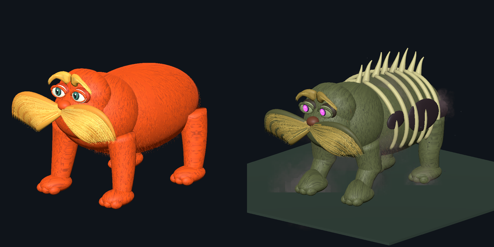
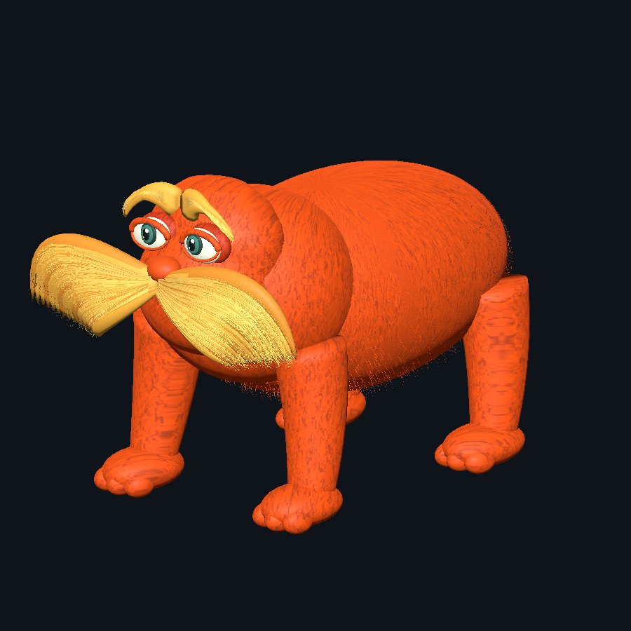
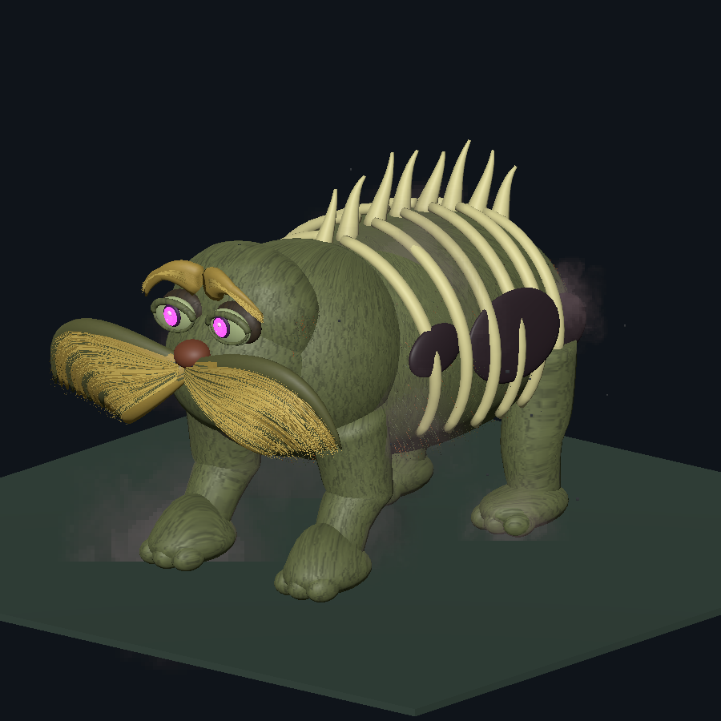

# Lox Lorax

Lox Lorax is a client-side Valheim visual mod that replaces living lox with an original animated orange forest-creature model and replaces Vile (`Unbjorn`) with an undead variant. It keeps Valheim's original AI, attacks, animation controller, hitboxes, drops, taming, and saddle behavior.



## Install and play

1. Install [BepInExPack Valheim 5.4.2351](https://thunderstore.io/c/valheim/p/denikson/BepInExPack_Valheim/) through r2modman, Thunderstore Mod Manager, or Gale and create a Valheim profile.
2. Download `LoxLorax-1.0.8-manual.zip` from the [latest GitHub release](https://github.com/Erfre/LoxLorax/releases/latest).
3. Extract the ZIP into that profile's game folder. Keep the `BepInEx/plugins/LoxLorax/` folders from the archive.
4. Start the modded profile and load a world. Existing and newly spawned lox and Vile creatures are replaced automatically.

Press **F8** in game to restore the vanilla creature models or enable the replacements again. The setting is saved.

## Features

- Original living and undead models; no Valheim mesh is redistributed.
- Seventeen-bone retargeting driven by each creature's native Animator.
- Vile paw contact adapted to the replacement's proportions.
- Exaggerated living-lox bite motion.
- Cosmetic death effect: the head detaches while the body launches skyward.
- **F8** instantly enables or disables all replacements and saves the choice.
- Client-side only. A dedicated server does not need the mod.

## Requirements

- Valheim 1.0.20 / Steam build 25909357, or a compatible later build.
- [BepInExPack Valheim 5.4.2351](https://thunderstore.io/c/valheim/p/denikson/BepInExPack_Valheim/).

## Other installation methods

### Mod manager

Install the package from Thunderstore or Hexium once its listing is published, then launch Valheim through r2modman, Thunderstore Mod Manager, or Gale.

### Manual

1. Install BepInExPack Valheim.
2. Extract `LoxLorax-1.0.8-manual.zip` into the Valheim directory or active mod-manager profile.
3. Confirm these files are together:

   ```text
   BepInEx/plugins/LoxLorax/LoxLorax.dll
   BepInEx/plugins/LoxLorax/lorax.llmesh
   BepInEx/plugins/LoxLorax/vile-lorax.llmesh
   ```

4. Launch Valheim with BepInEx enabled.

### Repository checkout

The tested binary and assets are committed under `dist/LoxLorax/`. After cloning the repository, copy that directory to `BepInEx/plugins/LoxLorax/`. Contributors can rebuild it by following [CONTRIBUTING.md](CONTRIBUTING.md).

## Controls and configuration

Press **F8** while playing to switch the mod off or on. Disabling restores vanilla lox and Vile models immediately; enabling updates creatures that are already loaded.

After the first launch, settings are stored in:

```text
BepInEx/config/com.loxlorax.mod.cfg
```

`ToggleKey` changes the hotkey. The config also controls living and Vile height, yaw, vertical offset, native motion, and whether the Vile replacement is enabled.

## Screenshots

### Living lox replacement — in game



### Vile replacement — in game



Additional front and Blender preview renders are in [`media/screenshots`](media/screenshots).

## Compatibility and known limits

- This is a visual replacement. Creature gameplay remains controlled by Valheim.
- Everyone who wants to see the replacement needs the mod on their own client.
- Valheim 1.0 treats any BepInEx session as modded and does not award Steam achievement progress during that session. F8 only toggles the models; use the mod manager's vanilla launch option to earn achievements.
- Renamed creature prefabs and other visual replacers are not supported.
- Full multiplayer, Windows, riding alignment, every terrain slope, and every combat transition have not been exhaustively verified.
- Updates to Valheim may require a new mod release.

## Validation

Version 1.0.8 was built against Valheim 1.0.20 and BepInExPack 5.4.2351. The release checks include:

- warning-free C# compilation;
- independent validation of mesh indices, normals, textures, winding, degenerates, bounds, and four grounded paws;
- a real isolated-world living-lox test, including live disable and re-enable;
- the actual Vile prefab evaluated through 30 native clips at five sample times each;
- 60 locomotion poses checked for ground penetration;
- verification that the death snapshot matches the live skinned geometry.

## Source and builds

The repository includes the C# source, deterministic Blender model generator, exported `.glb` files, runtime `.llmesh` assets, validators, and build scripts. Game assemblies and BepInEx binaries are not included.

See [CONTRIBUTING.md](CONTRIBUTING.md) for local build requirements and [RELEASE_PLAN.md](RELEASE_PLAN.md) for the publishing workflow.

## Credits and status

This is an unofficial fan-made mod. It is not affiliated with or endorsed by Iron Gate, Coffee Stain Publishing, Dr. Seuss Enterprises, or their partners. Valheim, The Lorax, and associated names and characters belong to their respective owners. See [DISCLAIMER.md](DISCLAIMER.md) and [LICENSE.md](LICENSE.md).

The code and model-development workflow were created with substantial generative-AI assistance. The implementation was produced almost entirely through AI prompting, followed by in-game testing and validation. Platform-specific AI disclosure tags should be applied where required.
